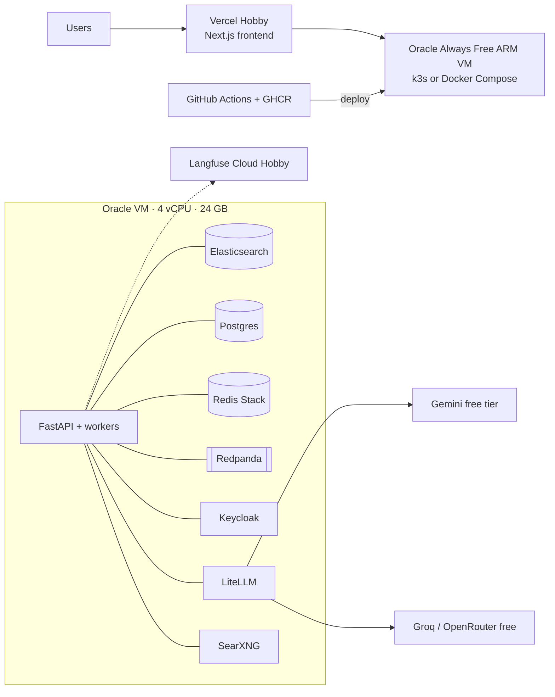

# Free / Low-Budget Guide

[← Back to roadmap](README.md)

You can build **all 6 phases for $0**. The strategy:

1. **Develop locally** with Docker Compose. Every open-source tool (Postgres, Elasticsearch, Redis, Kafka, Keycloak, Langfuse, MinIO, Ollama) runs free on your laptop.
2. **Use free API tiers** for things you can't run locally (Gemini, web search).
3. **Deploy on an always-free server**, not a paid managed service.
4. **Rent a GPU only for a few hours** (or use free notebook GPUs) for the Phase 5 benchmark.

> ⚠️ Free tiers change often. Check each provider's pricing page before you rely on a limit. Set **billing alerts / spending caps** on any account that asks for a card.

---

## Tool-by-Tool Free Options

| Tool in the plan | Free way to use it | Notes |
|---|---|---|
| **Gemini API** | Google AI Studio free tier (API key, no card) | Rate-limited (requests/min and /day); enough for dev and demos. Free-tier data may be used by Google, so don't send real private data |
| **Embeddings** | Gemini embeddings (free tier) or `bge-small-en-v1.5` / `e5-small` on CPU via `sentence-transformers` | Local CPU embeddings have zero cost and no rate limits |
| **Reranker** | `bge-reranker-base` on CPU | Rerank only top 20–30 to keep it fast |
| **PostgreSQL** | Docker locally; hosted: Neon or Supabase free tier | Or run it on your free VM (see Deployment) |
| **Elasticsearch** | Self-hosted Docker (free Basic license); give it ~1–2 GB heap | If RRF isn't available in your license/version, implement RRF in Python (~15 lines). **OpenSearch** is a fully open-source alternative with hybrid search |
| **Apache Tika / unstructured** | Docker / pip, free | — |
| **LangChain, LangGraph, MCP SDK, Ragas, promptfoo** | Open source, free | Ragas/promptfoo judge calls use your free Gemini quota; keep the golden set small (50 Qs) |
| **Web search** | **SearXNG** self-hosted (free, unlimited); Tavily free monthly credits | Cache search results in Redis to save credits |
| **File storage (attachments)** | MinIO in Docker; hosted: Cloudflare R2 free tier | R2 has no egress fees |
| **Langfuse** | Langfuse Cloud Hobby (free) or self-host with Docker | Cloud hobby is easiest; self-host needs more RAM |
| **OpenTelemetry + Grafana** | Grafana Cloud free tier, or Grafana + Prometheus + Tempo in Docker | Langfuse alone is enough if RAM is tight |
| **Presidio, LLM Guard, ClamAV** | Open source, free | LLM Guard models run on CPU |
| **Ollama** | Free, local | 7–8B Q4 models need ~8 GB RAM; use 1.5B–3B models (`qwen2.5:3b`, `llama3.2:3b`) on smaller laptops |
| **vLLM on GPU** | Free GPUs: Google Colab, Kaggle notebooks (weekly free GPU hours); Modal's monthly free credits | Run the benchmark in one session instead of keeping a GPU server up |
| **Hosted open models (no GPU)** | Groq free tier, OpenRouter free models | OpenAI-compatible APIs, plug straight into LiteLLM as "self-hosted-like" options |
| **LiteLLM** | Open source, free | Run as a container |
| **TEI** | Free container; runs on CPU for small embedding models | — |
| **Keycloak** | Self-hosted Docker, free | Uses ~512 MB–1 GB RAM. Lighter alternative: FastAPI OAuth2 + JWT yourself, or Supabase Auth free tier |
| **Redis** | Docker locally; hosted: Upstash free tier | Use **Redis Stack** image for vector search (semantic cache) |
| **Kafka** | **Redpanda** single-node in Docker (lighter, Kafka-compatible) | On a tiny server, swap Kafka for **Redis Streams** or **Celery + Redis** — same pattern, less RAM |
| **Docker** | Free | — |
| **Kubernetes** | **kind / k3d** locally; **k3s** on a free VM | Managed K8s (GKE/EKS) costs money; k3s gives the same skills |
| **GitHub Actions** | Free for public repos (minutes limited for private) | Keep the repo **public**: it's also your portfolio |
| **Container registry** | GitHub Container Registry (GHCR), free for public images | — |
| **Jira (MCP tool)** | Jira Cloud free plan (small teams) | Or build the MCP tool on your own Postgres table only |
| **Frontend hosting** | Vercel Hobby or Cloudflare Pages / Netlify free | Next.js deploys to Vercel in one click |

---

## Free Deployment Options

| Option | What you get (free) | Good for | Watch out for |
|---|---|---|---|
| **Oracle Cloud Always Free** ⭐ | Ampere ARM VM(s) with up to 4 vCPU and 24 GB RAM in total | Running the **whole stack** (Postgres, Elasticsearch, Redis, Redpanda, Keycloak, API, workers) with Docker Compose or **k3s** | Signup needs a card for verification; capacity in popular regions can be limited; use ARM-compatible images |
| **Hugging Face Spaces** | Free CPU Docker Spaces (several GB RAM) | Demo of the FastAPI backend or a Gradio/Streamlit demo; hosting small models on CPU | Sleeps when idle; public by default |
| **Render / Koyeb free web services** | Small free container | Just the FastAPI API | Sleep on idle, low RAM — not enough for Elasticsearch |
| **Vercel / Netlify / Cloudflare Pages** | Free static + serverless hosting | Next.js frontend | — |
| **Neon / Supabase / Upstash** | Free managed Postgres / Redis | When you don't want to run DBs yourself | Storage and request limits |
| **Elastic Cloud trial** | Short free trial | Testing managed Elasticsearch | It expires — self-host for the long term |
| **GitHub Student Developer Pack** | Free credits on several clouds (if you're a student) | Extra headroom | Eligibility required |

### Recommended $0 Production Setup

Add free HTTPS with **Caddy** or Traefik + Let's Encrypt, and a free domain/subdomain (e.g. DuckDNS) or Cloudflare Tunnel (no open ports needed).

---

## Per-Phase $0 Plan

| Phase | Free approach | Est. cost |
|---|---|---|
| 1. Streaming chat | Gemini free tier, Postgres in Docker, Next.js local / Vercel | $0 |
| 2. RAG + hybrid | ES + Tika in Docker, local CPU embeddings + reranker | $0 |
| 3. Agent + workflows | LangGraph, MCP SDK, SearXNG for web search, MinIO for attachments | $0 |
| 4. Evals + observability | Ragas with Gemini free tier as judge, Langfuse Cloud Hobby, GitHub Actions (public repo) | $0 |
| 5. Self-hosted model | Ollama locally, Groq/OpenRouter free models, one Colab/Kaggle GPU session for the vLLM benchmark | $0 (optionally ~$1–5 of RunPod time for a cleaner benchmark) |
| 6. Production-grade | Oracle Always Free VM + k3s, Redpanda or Redis Streams, Keycloak, Vercel frontend, GHCR | $0 |

## Money-Saving Tips

- **Cache everything:** semantic cache for answers, Redis cache for web search and embeddings.
- **Use small models where possible:** Gemini Flash / Flash-Lite for routing, rewriting and judging; bigger models only for final answers.
- **Embed once:** don't re-embed unchanged documents (hash the content).
- **Small golden set:** 50 well-chosen questions beat 500 random ones, and cost 10× less to evaluate.
- **Run evals only on PRs that touch the pipeline** (`paths:` filter in GitHub Actions).
- **Turn off GPU servers right after benchmarking**; record results in `BENCHMARK.md`.
- **Low-RAM laptop?** Use OpenSearch/Elasticsearch with a small heap, Redis Streams instead of Kafka, Langfuse Cloud instead of self-hosting, and a 3B model in Ollama.
