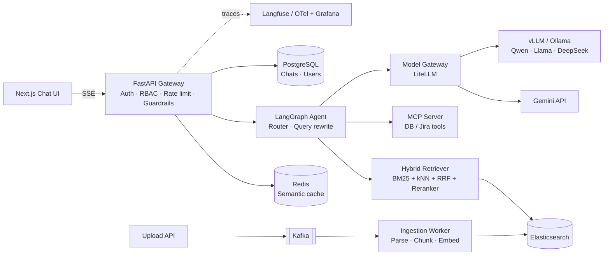

# LLM Project — From Streaming Chat to Production-Grade AI Copilot

A hands-on, phase-by-phase roadmap for building a production-quality LLM application with a **Python backend**.
The plan has **6 phases**. Each phase ends with a **working, demo-able deliverable** and its own GitHub release/tag.

> **Domain angle (recommended):** Turn this into a **"Dark Store Ops Copilot"** that answers questions about SOPs, inventory, and expiry. A domain-specific copilot is a much stronger interview story than a generic chatbot.

---

> 💸 **On a budget?** See the [Free / Low-Budget Guide](FREE_TIER_GUIDE.md): every phase can be built and deployed for $0.

## Phase Guides

1. [Phase 1](phases/phase-1-streaming-chat/README.md)
2. [Phase 2](phases/phase-2-rag-hybrid-search/README.md)
3. [Phase 3](phases/phase-3-agent-workflows/README.md)
4. [Phase 4](phases/phase-4-evals-observability/README.md)
5. [Phase 5](phases/phase-5-self-hosted-models/README.md)
6. [Phase 6](phases/phase-6-production-grade/README.md)

## Tech Stack at a Glance

| Layer | Choice |
|---|---|
| Frontend | React / Next.js |
| Backend | Python 3.11+, FastAPI (async, SSE streaming), Pydantic |
| LLM | Google Gemini API (Phases 1–4) → self-hosted open-weight models (Phase 5) |
| LLM framework | LangChain / LlamaIndex, LangGraph |
| Databases | PostgreSQL (SQLAlchemy + Alembic), Elasticsearch 8.x, Redis |
| Evals & observability | Ragas / promptfoo, Langfuse / OpenTelemetry + Grafana |
| Infra | Docker, Kubernetes, GitHub Actions, Kafka |

## Architecture

---

## Phase 1 — ChatGPT-style Basic Chat (Streaming)

📄 **Detailed guide:** [phases/phase-1-streaming-chat/README.md](phases/phase-1-streaming-chat/README.md)

**Build**
- Chat UI where tokens stream live.
- Conversation history, "New chat" button, and a list of past chats.

**Tools**
- React or Next.js
- FastAPI with Server-Sent Events (`StreamingResponse` / `sse-starlette`)
- Google Gemini API (`google-genai` SDK, or LangChain `ChatGoogleGenerativeAI`)
- PostgreSQL (SQLAlchemy + Alembic)

**Demo:** Open the app, start a chat, watch the answer stream token by token, reload and reopen an old chat.

---

## Phase 2 — RAG + Hybrid Search

📄 **Detailed guide:** [phases/phase-2-rag-hybrid-search/README.md](phases/phase-2-rag-hybrid-search/README.md)

**Build**
- Upload documents (PDF/DOCX). The backend chunks and embeds them and stores them in Elasticsearch.
- Search runs two ways: **keyword (BM25)** and **vector (kNN)**.
- Merge both result sets with **Reciprocal Rank Fusion (RRF)**, then have the LLM generate the answer.
- Show **citations** in the UI (which source the answer came from).

**Tools**
- Parsing: Apache Tika (`tika-python`), or `unstructured` / `pypdf` / `python-docx`
- Elasticsearch 8.x (BM25 + `dense_vector` + RRF) via the `elasticsearch` Python client
- An embedding model (Gemini embeddings, or `sentence-transformers` such as `bge-small` / `e5`)
- **Bonus:** a cross-encoder reranker such as `bge-reranker`

**Demo:** Upload an SOP PDF, ask a question, get an answer with clickable citations.

---

## Phase 3 — Agent + Workflows

📄 **Detailed guide:** [phases/phase-3-agent-workflows/README.md](phases/phase-3-agent-workflows/README.md)

**Build**
- The agent decides on its own whether to run RAG, call a tool, or answer directly.
- Query rewriting, a router, and multi-step workflows.
- Build your own **MCP server** (e.g. a DB or Jira tool) and have the agent call it through an MCP client.
- **Web search tool:** the agent searches the internet when the answer isn't in the docs or needs fresh info (prices, news, regulations), reads the top pages and cites the URLs.
- **File upload in chat:** attach a file (PDF, DOCX, CSV/Excel, image) to a message and ask about it right away. The file is parsed and indexed only for that conversation; CSV/Excel can be answered with a pandas tool.
- Show the agent's steps in the UI ("Searching docs...", "Searching the web...", "Reading attachment...", "Calling tool...").

**Tools**
- LLM tool/function calling (Gemini function calling or LangChain tools)
- **LangGraph** for the workflow graph
- **MCP Python SDK** (`mcp` / `FastMCP`) for the server and client
- Web search: **Tavily** API (built for LLM agents), or self-hosted **SearXNG**; page reading with `trafilatura` / `httpx`
- Chat attachments: FastAPI `UploadFile`, MinIO/S3 for file storage, `unstructured` / Tika for parsing, `pandas` for spreadsheets, Gemini vision for images

**Demo:** Ask "How many SKUs expire this week and what is the SOP for them?" and watch the agent query the DB tool, search docs, and combine the results. Ask "What are the latest FSSAI rules on expiry labels?" to see web search with URL citations, and attach a stock CSV to ask "Which items are below reorder level?"

---

## Phase 4 — Evals + Observability

📄 **Detailed guide:** [phases/phase-4-evals-observability/README.md](phases/phase-4-evals-observability/README.md)

> In a portfolio, this phase is what sets you apart the most.

**Build**
- A **golden Q&A dataset**, with automatic evals after every change (faithfulness, answer relevance, retrieval recall), run in CI.
- A **trace** for every request: latency, tokens, cost.
- **Guardrails:** PII masking and prompt-injection checks.

**Tools**
- Ragas or promptfoo (plus `pytest` to gate CI)
- Langfuse, or OpenTelemetry + Grafana
- Guardrails: Microsoft Presidio (PII), LLM Guard / NeMo Guardrails (prompt injection)

**Demo:** Open a PR, and the CI posts the eval scores; open the Langfuse dashboard to see per-request traces and costs.

---

## Phase 5 — Self-Host an Open-Weight Model

📄 **Detailed guide:** [phases/phase-5-self-hosted-models/README.md](phases/phase-5-self-hosted-models/README.md)

**Build**
- Use your own hosted model in place of Gemini.
- A **model gateway** so the model can be switched through config, with **fallback** to another model when one fails.
- A **benchmark report** on quality, latency, and cost: Gemini vs self-hosted.

**Tools**
- Local: **Ollama**
- Production-like: **vLLM** on a GPU cloud (RunPod / Modal)
- Models: open weights from Qwen, Llama, or DeepSeek, quantized (AWQ / GGUF)
- Gateway: **LiteLLM**
- Self-hosted embeddings: **TEI** (Text Embeddings Inference)

**Demo:** Change one config value to switch models; stop the primary model and watch requests fall back automatically; publish the benchmark table.

---

## Phase 6 — Make It Production-Grade

📄 **Detailed guide:** [phases/phase-6-production-grade/README.md](phases/phase-6-production-grade/README.md)

**Build**
- Auth and a **multi-tenant** setup (each user's docs kept separate).
- **RBAC (Role-Based Access Control):**
  - Roles such as `admin`, `manager`, `operator` and `viewer`, scoped per tenant.
  - API-level permissions (e.g. only `admin`/`manager` can upload or delete docs, only `admin` can manage users and models).
  - **Document-level access in RAG:** each chunk stores `tenant_id` and `allowed_roles`; Elasticsearch queries add a filter so retrieval never returns chunks the user is not allowed to see.
  - **Feature access by role:** e.g. web search and chat attachments allowed for `operator` and above; file size/type limits per role.
  - **Tool-level access for the agent:** MCP tools declare required roles (e.g. a write-to-DB tool only for `manager`), checked before every tool call.
  - Audit log of who accessed or changed what.
- **Rate limiting.**
- **Semantic cache** (similar questions get a cached answer).
- **Async ingestion pipeline.**
- Deploy the whole system.

**Tools**
- Auth: Keycloak, or FastAPI security with OAuth2/JWT
- RBAC: Keycloak realm/client roles in JWT claims, enforced with FastAPI dependencies (`Depends(require_role(...))`); optionally Casbin or OpenFGA for fine-grained policies
- Redis (semantic cache + rate limiting, e.g. `slowapi` / RedisVL)
- Kafka (ingestion queue, `aiokafka`), or Celery workers
- Docker, Kubernetes, GitHub Actions

**Demo:** Two users log in and see only their own docs; a `viewer` cannot upload docs or trigger write tools, and asking about a restricted doc returns no citations from it; a burst of requests gets rate-limited; a repeated question returns instantly from cache; it all runs on Kubernetes.

---

## What's Next (Extensions)

- **Memory:** long-term user memory that persists across sessions
- **Multi-agent:** planner, researcher, and reviewer agents; try the **A2A protocol** too
- **Multimodal:** understanding images and tables inside PDFs, plus voice input
- **Fine-tuning:** LoRA on your own domain data (**Unsloth**)
- **GraphRAG:** RAG over a knowledge graph (**Neo4j**)
- **Domain angle:** make it a **Dark Store Ops Copilot** that answers questions about SOPs, inventory, and expiry

---

## Releases & Results

**Tip:** Create a separate GitHub release/tag for each phase, and keep the architecture diagram and eval numbers in this README. Interviewers find this the most impressive.

| Phase | Tag | Status |
|---|---|---|
| 1. Streaming chat | `v0.1-chat` | ✅ code ready |
| 2. RAG + hybrid search | `v0.2-rag` | ✅ code ready |
| 3. Agent + workflows | `v0.3-agent` | ✅ code ready |
| 4. Evals + observability | `v0.4-evals` | ⬜ |
| 5. Self-hosted model | `v0.5-selfhost` | ⬜ |
| 6. Production-grade | `v1.0` | ⬜ |

### Eval Results (fill in after Phase 4)

| Metric | Baseline | + Hybrid | + Reranker | Self-hosted |
|---|---|---|---|---|
| Faithfulness | – | – | – | – |
| Answer relevance | – | – | – | – |
| Retrieval recall@k | – | – | – | – |
| p95 latency (s) | – | – | – | – |
| Cost / 1K requests ($) | – | – | – | – |
