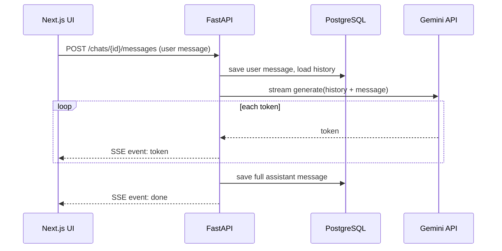

# Phase 1 — ChatGPT-style Basic Chat (Streaming)

**Release tag:** `v0.1-chat` · [← Back to roadmap](../../README.md) · [Next: Phase 2 →](../phase-2-rag-hybrid-search/README.md)

## Goal

Build a ChatGPT-like chat app where answers **stream token by token**, conversations are **saved**, and the user can start a **new chat** or reopen **old chats**.

## Features

| Feature | Description |
|---|---|
| Live token streaming | Tokens appear in the UI as the LLM generates them (SSE) |
| Conversation history | Every message is stored and replayed as context on the next turn |
| New chat | Creates a new conversation with an auto-generated title |
| Chat list | Sidebar listing past chats, sorted by last activity |
| Stop generation | Cancel an in-flight stream |
| Markdown rendering | Code blocks, lists and tables rendered in the UI |

## Architecture



## Tools & Why

| Tool | Role in this phase | Notes |
|---|---|---|
| **Next.js (React)** | Chat UI, sidebar, streaming rendering | Read the stream with `fetch` + `ReadableStream` or `EventSource`; `react-markdown` for rendering |
| **FastAPI** | Async REST API + SSE endpoint | `StreamingResponse` or `sse-starlette`'s `EventSourceResponse` |
| **Gemini API** | The LLM | `google-genai` SDK (`generate_content_stream`) or LangChain `ChatGoogleGenerativeAI.astream()` |
| **PostgreSQL** | Stores chats and messages | Use `asyncpg` driver |
| **SQLAlchemy 2.0 + Alembic** | ORM and DB migrations | Async sessions |
| **Pydantic / pydantic-settings** | Request/response schemas, config from `.env` | Keep the API key out of code |
| **Docker Compose** | Runs Postgres (and later everything) locally | One `docker compose up` |

## Data Model

```sql
conversations (id UUID PK, title TEXT, created_at TIMESTAMPTZ, updated_at TIMESTAMPTZ)
messages      (id UUID PK, conversation_id UUID FK, role TEXT CHECK (role IN ('user','assistant','system')),
               content TEXT, tokens_in INT, tokens_out INT, created_at TIMESTAMPTZ)
```

## API Endpoints

| Method | Path | Purpose |
|---|---|---|
| `POST` | `/api/chats` | Create a new conversation |
| `GET` | `/api/chats` | List conversations |
| `GET` | `/api/chats/{id}` | Get a conversation with its messages |
| `POST` | `/api/chats/{id}/messages` | Send a message, response is an SSE stream |
| `DELETE` | `/api/chats/{id}` | Delete a conversation |

**SSE event format:** `event: token` / `data: {"text": "..."}`, then `event: done` / `data: {"message_id": "..."}`; on failure `event: error`.

## Suggested Folder Structure

```
backend/
  app/
    main.py            # FastAPI app, CORS, routers
    config.py          # pydantic-settings
    db/                # models.py, session.py, alembic/
    api/chats.py       # routes
    services/llm.py    # Gemini streaming wrapper
    services/chat.py   # history building, persistence
frontend/
  app/ (Next.js)       # chat page, sidebar, message components
docker-compose.yml
```

## Implementation Steps

1. Docker Compose with Postgres; FastAPI skeleton with `/health`.
2. SQLAlchemy models + first Alembic migration.
3. Chat CRUD endpoints.
4. Gemini streaming wrapper (async generator yielding text chunks).
5. SSE endpoint: save user message → stream → save assistant message.
6. History window: send the last N messages (or trim by token count) as context.
7. Auto-title the chat from the first message (one short LLM call).
8. Next.js UI: sidebar, chat view, streaming render, stop button.

## Key Concepts to Learn

- How SSE works vs WebSockets, and why SSE fits one-way token streaming.
- Async generators in Python and back-pressure.
- Context window limits and history trimming.
- Handling client disconnects (stop generation cleanly).

## Definition of Done / Demo

- [ ] Answer streams token by token in the UI
- [ ] Reloading the page keeps the conversation
- [ ] Sidebar shows old chats; clicking one reopens it
- [ ] "New chat" works; stop button cancels the stream

## Interview Talking Points

- Why SSE over WebSockets for streaming LLM output.
- How history is stored and trimmed to fit the context window.
- How you handled errors mid-stream and client disconnects.
