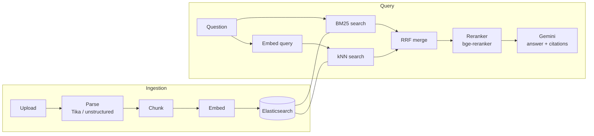

# Phase 2 — RAG + Hybrid Search

**Release tag:** `v0.2-rag` · [← Phase 1](../phase-1-streaming-chat/README.md) · [Back to roadmap](../../README.md) · [Next: Phase 3 →](../phase-3-agent-workflows/README.md)

## Goal

Let users **upload documents (PDF/DOCX)** and ask questions about them. Retrieval combines **keyword search (BM25)** and **vector search (kNN)**, merged with **Reciprocal Rank Fusion (RRF)**. Answers show **citations**.

## Features

| Feature | Description |
|---|---|
| Document upload | PDF/DOCX upload with status (processing / ready / failed) |
| Parsing | Extract text, keep page numbers and headings |
| Chunking | Split text into overlapping chunks with metadata |
| Embedding | Convert each chunk into a dense vector |
| Hybrid search | BM25 + kNN, merged with RRF |
| Reranking (bonus) | Cross-encoder reorders the top candidates |
| Grounded answer | LLM answers only from retrieved chunks |
| Citations | UI shows which doc/page each part of the answer came from |

## Architecture



## Tools & Why

| Tool | Role in this phase | Notes |
|---|---|---|
| **Apache Tika** (`tika-python`) | Parses PDF/DOCX into text | Runs as a Docker container; alternatives: `unstructured`, `pypdf`, `python-docx`, `pymupdf` |
| **LangChain text splitters** | Chunking | `RecursiveCharacterTextSplitter`, ~500–800 tokens, 10–15% overlap |
| **Embedding model** | Text → vector | Gemini `text-embedding-004`, or `sentence-transformers` (`BAAI/bge-small-en-v1.5`, `intfloat/e5-base-v2`) |
| **Elasticsearch 8.x** | Stores chunks; BM25 + `dense_vector` kNN + RRF | Official `elasticsearch` async Python client |
| **bge-reranker** (bonus) | Cross-encoder reranking | `BAAI/bge-reranker-base` via `sentence-transformers` `CrossEncoder` |
| **FastAPI `UploadFile` + BackgroundTasks** | Upload and background ingestion | Moves to Kafka in Phase 6 |
| **Gemini API** | Answer generation | Prompt forces citing chunk IDs |

## Elasticsearch Index Mapping

```json
{
  "mappings": {
    "properties": {
      "doc_id":    { "type": "keyword" },
      "doc_name":  { "type": "keyword" },
      "page":      { "type": "integer" },
      "chunk_id":  { "type": "keyword" },
      "text":      { "type": "text", "analyzer": "english" },
      "embedding": { "type": "dense_vector", "dims": 768, "index": true, "similarity": "cosine" }
    }
  }
}
```

## Hybrid Search with RRF

Elasticsearch 8.x supports RRF with a `retriever`:

```json
{
  "retriever": {
    "rrf": {
      "retrievers": [
        { "standard": { "query": { "match": { "text": "expiry SOP for dairy" } } } },
        { "knn": { "field": "embedding", "query_vector": [/* ... */], "k": 50, "num_candidates": 200 } }
      ],
      "rank_window_size": 50,
      "rank_constant": 60
    }
  },
  "size": 20
}
```

RRF score for a document: `Σ 1 / (k + rank_i)`. If your ES license doesn't include RRF, implement it in Python (~15 lines).

## API Endpoints

| Method | Path | Purpose |
|---|---|---|
| `POST` | `/api/documents` | Upload a file, returns `doc_id` |
| `GET` | `/api/documents` | List documents and status |
| `DELETE` | `/api/documents/{id}` | Delete doc and its chunks |
| `POST` | `/api/chats/{id}/messages` | Now runs RAG; SSE adds a `citations` event |
| `GET` | `/api/search?q=` | Debug endpoint: raw hybrid results with scores |

## Implementation Steps

1. Add Elasticsearch + Tika to Docker Compose; create the index.
2. Upload endpoint → save file → background ingestion task.
3. Parse → chunk (keep page numbers) → embed in batches → bulk index.
4. BM25-only search, then kNN-only, then RRF merge; compare results on a few questions.
5. Prompt template: numbered context chunks, "answer only from context, cite [n]".
6. Stream answer; send citations (doc name, page, snippet) as a separate SSE event.
7. UI: upload page, doc list, clickable citation chips.
8. Bonus: rerank top 20–50 to top 5 with bge-reranker, measure the difference.

## Key Concepts to Learn

- Why hybrid beats either alone: BM25 catches exact terms (SKU codes, IDs), vectors catch meaning.
- Chunk size/overlap trade-offs.
- Bi-encoder (embedding) vs cross-encoder (reranker).
- Hallucination control through grounding and "I don't know" answers.

## Definition of Done / Demo

- [ ] Upload a PDF and see it become "ready"
- [ ] Ask a question and get an answer with citations to doc + page
- [ ] `/api/search` shows BM25, kNN and fused ranks
- [ ] Questions outside the docs get "I couldn't find this in your documents"

## Interview Talking Points

- How RRF works and why it doesn't need score normalization.
- Your chunking strategy and how you chose it.
- Measured impact of the reranker (fill in numbers once Phase 4 evals exist).
