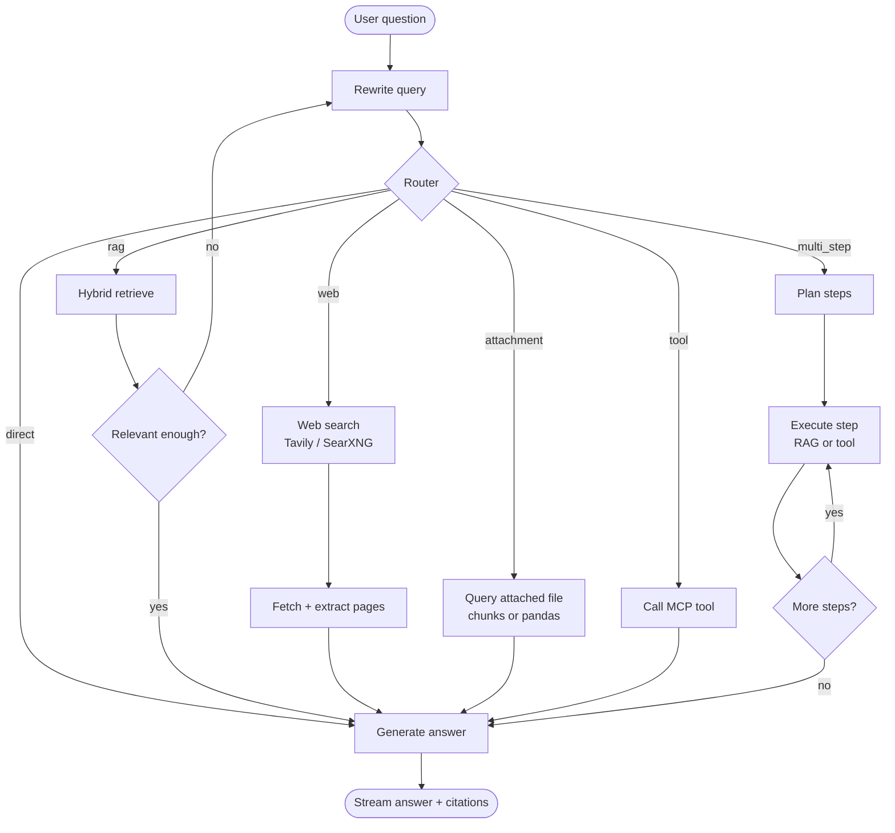

# Phase 3 — Agent + Workflows

**Release tag:** `v0.3-agent` · [← Phase 2](../phase-2-rag-hybrid-search/README.md) · [Back to roadmap](../../README.md) · [Next: Phase 4 →](../phase-4-evals-observability/README.md)

## Goal

Turn the chat into an **agent** that decides on its own whether to **search docs (RAG)**, **search the web**, **read a file attached in chat**, **call a tool**, or **answer directly**. Add **query rewriting**, a **router**, **multi-step workflows**, and your own **MCP server**. The UI shows each agent step live.

## Features

| Feature | Description |
|---|---|
| Router | Classifies the question: `direct`, `rag`, `web`, `attachment`, `tool`, or `multi_step` |
| Query rewriting | Turns follow-ups ("what about dairy?") into standalone queries; can split into sub-queries |
| Tool calling | LLM picks tools and arguments (function calling) |
| Multi-step workflows | Plan → execute steps → combine results, with loops and retries |
| MCP server | Your own server exposing tools (e.g. inventory DB, Jira) |
| MCP client | Agent discovers and calls MCP tools at runtime |
| Web search | Agent searches the internet for fresh or out-of-docs info, reads top pages, cites URLs |
| File upload in chat | Attach PDF/DOCX/CSV/Excel/image to a message and ask about it immediately (conversation-scoped) |
| Step streaming | UI shows "Rewriting query...", "Searching docs...", "Calling tool get_expiring_skus..." |

## Agent Graph



## Tools & Why

| Tool | Role in this phase | Notes |
|---|---|---|
| **LangGraph** | Builds the agent as a state graph (nodes, conditional edges, loops) | `StateGraph`, checkpointer for state; `astream_events` to stream steps |
| **Gemini function calling** / LangChain tools | LLM selects tools with typed args | Define tools with Pydantic schemas |
| **MCP Python SDK** (`mcp`, `FastMCP`) | Build your MCP server and client | Server: `@mcp.tool()` decorators; transport: stdio or streamable HTTP |
| **langchain-mcp-adapters** | Loads MCP tools as LangChain tools | Lets LangGraph use MCP tools directly |
| **PostgreSQL** | Backing data for the inventory tool (SKUs, stock, expiry) | Seed with sample dark-store data |
| **Jira REST API** (optional) | Second MCP tool: create/search tickets | Use a free Jira Cloud site |
| **Tavily API** | Web search built for LLM agents; returns clean snippets and content | `langchain-tavily` / `tavily-python`; free tier available |
| **SearXNG** (alternative) | Self-hosted meta search engine, no API key | Run in Docker; JSON output |
| **trafilatura** + **httpx** | Fetch and extract main text from web pages | Respect robots.txt, set timeouts |
| **MinIO / S3** | Stores files attached in chat | MinIO in Docker locally |
| **unstructured / Tika** | Parses chat attachments | Reuse the Phase 2 parser |
| **pandas** | Answers questions over CSV/Excel attachments | Expose as a safe, read-only tool (no arbitrary code execution) |
| **Gemini vision** | Understands image attachments (shelf photos, labels) | Send image + question in one request |

## Example MCP Server (Dark Store tools)

```python
from mcp.server.fastmcp import FastMCP

mcp = FastMCP("darkstore-tools")

@mcp.tool()
async def get_expiring_skus(days: int = 7, category: str | None = None) -> list[dict]:
    """List SKUs expiring within `days`, optionally filtered by category."""
    ...

@mcp.tool()
async def get_stock(sku_id: str) -> dict:
    """Current stock level and location for a SKU."""
    ...

@mcp.tool()
async def create_ticket(title: str, description: str) -> dict:
    """Create a Jira ticket for an ops issue."""
    ...

if __name__ == "__main__":
    mcp.run(transport="streamable-http")
```

## Web Search Tool

```python
@tool
async def web_search(query: str, max_results: int = 5) -> list[dict]:
    """Search the internet for recent or external information. Use when the
    answer is not in the user's documents or needs up-to-date facts."""
    results = await tavily.search(query, max_results=max_results, include_raw_content=True)
    return [{"title": r["title"], "url": r["url"], "content": r["content"][:2000]} for r in results["results"]]
```

- Prefer internal docs first; use the web for freshness or when RAG finds nothing relevant.
- Always cite URLs; label web sources differently from internal docs in the UI.
- Treat web content as **untrusted** (indirect prompt injection), sanitize it before it enters the prompt (checked in Phase 4).
- Optional: domain allow-list (e.g. government or supplier sites) for an ops copilot.

## File Upload in Chat

| Step | What happens |
|---|---|
| 1. Attach | `POST /api/chats/{id}/attachments` (multipart), file saved to MinIO |
| 2. Parse | PDF/DOCX → text chunks; CSV/Excel → DataFrame schema + preview; image → kept for vision |
| 3. Index | Chunks indexed with `conversation_id` (and an expiry), separate from the shared knowledge base |
| 4. Ask | Router picks `attachment`; retrieval is filtered to `conversation_id` |
| 5. Promote (optional) | "Add to knowledge base" button sends the file through the Phase 2 ingestion pipeline |

Small files (a few pages) can be put directly into the prompt instead of being chunked.

## Agent State

```python
class AgentState(TypedDict):
    messages: list            # chat history
    rewritten_query: str
    route: Literal["direct", "rag", "web", "attachment", "tool", "multi_step"]
    attachments: list[dict]   # files attached to this conversation
    web_results: list[dict]
    plan: list[str]
    retrieved_chunks: list[dict]
    tool_results: list[dict]
    steps_log: list[str]      # streamed to UI
```

## SSE Events Added

| Event | Example payload |
|---|---|
| `step` | `{"node": "retrieve", "status": "started", "label": "Searching docs..."}` |
| `tool_call` | `{"tool": "get_expiring_skus", "args": {"days": 7}}` |
| `tool_result` | `{"tool": "get_expiring_skus", "summary": "12 SKUs found"}` |
| `token` / `citations` / `done` | Same as earlier phases |

## Implementation Steps

1. Wrap Phase 2 retrieval as a tool (`search_documents`).
2. Build the MCP server with 2–3 tools over a seeded Postgres inventory table.
3. Connect via MCP client; list tools at startup.
4. Build the LangGraph graph: rewrite → route → (direct | rag | tool | plan/execute) → answer.
5. Add a relevance-grading node with a max-retry limit (avoid infinite loops).
6. Stream graph events to the UI as `step` events; render a collapsible "agent steps" panel.
7. Add the `web_search` tool (Tavily or SearXNG) + page extraction; show URL citations.
8. Add chat attachments: upload endpoint, MinIO storage, conversation-scoped indexing, pandas tool for spreadsheets, vision for images.
9. Test with questions that need 0, 1 and 2+ steps, plus web-only and attachment-only questions.

## Key Concepts to Learn

- Agents vs workflows: when to let the LLM decide vs hardcode the flow.
- Tool schema design (clear names, descriptions, typed args).
- MCP: servers, clients, tools/resources/prompts, transports.
- Loop guards, timeouts, and graceful failure when a tool errors.

## Definition of Done / Demo

- [ ] "Hi" is answered directly (no retrieval)
- [ ] An SOP question triggers RAG with citations
- [ ] "How many dairy SKUs expire this week?" calls the MCP inventory tool
- [ ] "Which SKUs expire this week and what's the SOP for them?" runs a multi-step plan
- [ ] "Latest FSSAI expiry-label rules?" triggers web search with URL citations
- [ ] Attaching a stock CSV and asking "which items are below reorder level?" works without adding it to the knowledge base
- [ ] Attaching a shelf photo and asking about it works (vision)
- [ ] UI shows every step live

## Interview Talking Points

- Why LangGraph (explicit state + control flow) over a free-running ReAct loop.
- How MCP decouples tools from the agent.
- How you prevented loops and handled tool failures.
