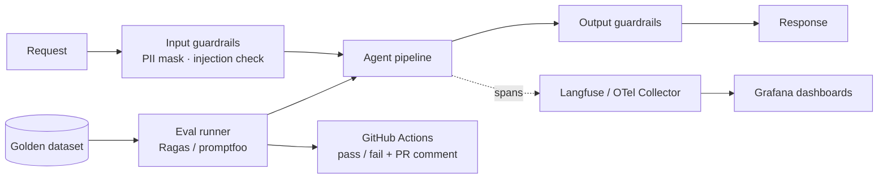

# Phase 4 — Evals + Observability

**Release tag:** `v0.4-evals` · [← Phase 3](../phase-3-agent-workflows/README.md) · [Back to roadmap](../../README.md) · [Next: Phase 5 →](../phase-5-self-hosted-models/README.md)

> In a portfolio, this phase is what sets you apart the most. Most LLM projects stop at "it works on my examples"; this one **measures** quality.

## Goal

1. Build a **golden Q&A dataset** and run **automatic evals** on every change (faithfulness, answer relevance, retrieval recall).
2. **Trace** every request: latency, tokens, cost, each agent step.
3. Add **guardrails**: PII masking and prompt-injection checks.

## Features

| Feature | Description |
|---|---|
| Golden dataset | 50–150 questions with expected answers and the source chunks/docs that answer them |
| Offline evals | Script that runs the pipeline on the dataset and scores it |
| CI eval gate | GitHub Actions runs evals on PRs; fails if scores drop below thresholds |
| Request tracing | Every request → trace with spans for rewrite, retrieve, rerank, LLM, tools |
| Cost tracking | Tokens in/out × price per model, per request and per day |
| Dashboards | p50/p95 latency, error rate, cost, eval scores over time |
| PII masking | Emails, phone numbers, names etc. masked before sending to the LLM and in logs |
| Prompt-injection check | Detect "ignore previous instructions"-style attacks in user input and retrieved docs |
| User feedback | 👍/👎 in the UI, attached to the trace |

## Architecture



## Tools & Why

| Tool | Role in this phase | Notes |
|---|---|---|
| **Ragas** | RAG metrics: faithfulness, answer relevancy, context precision, context recall | Python, works with any LLM as judge |
| **promptfoo** (alternative) | YAML-driven test cases, assertions, model comparison | Good for prompt regression tests |
| **pytest** | Wraps eval runs, asserts thresholds | Runs in CI |
| **Langfuse** | LLM tracing, cost, prompt versions, datasets, user feedback | Self-host with Docker; Python SDK `@observe` decorator / LangChain callback |
| **OpenTelemetry + Grafana** (alternative/extra) | Standard traces/metrics; Tempo for traces, Prometheus for metrics, Grafana dashboards | `opentelemetry-instrumentation-fastapi` |
| **Microsoft Presidio** | PII detection and anonymization | `presidio-analyzer` + `presidio-anonymizer` |
| **LLM Guard** / **NeMo Guardrails** | Prompt-injection and jailbreak detection, output checks | LLM Guard has a ready `PromptInjection` scanner |
| **GitHub Actions** | Runs evals on every PR | Posts score table as a PR comment |

## Metrics

| Metric | What it measures | Target (example) |
|---|---|---|
| **Faithfulness** | Is every claim in the answer supported by retrieved context? | ≥ 0.85 |
| **Answer relevancy** | Does the answer actually address the question? | ≥ 0.80 |
| **Retrieval recall@k** | Is the gold chunk in the top-k retrieved? | ≥ 0.90 @ k=5 |
| **Context precision** | Are relevant chunks ranked above irrelevant ones? | ≥ 0.75 |
| **Tool selection accuracy** | Did the agent pick the right route/tool? | ≥ 0.90 |
| **p95 latency** | End-to-end response time | < 6 s |
| **Cost / request** | Tokens × price | Track trend |

## Golden Dataset Format

```jsonl
{"id": "q001", "question": "What is the SOP for dairy items expiring within 24 hours?", "ground_truth": "Move to markdown shelf and apply 30% discount...", "gold_doc": "SOP_Expiry_v3.pdf", "gold_pages": [4], "expected_route": "rag"}
{"id": "q002", "question": "How many dairy SKUs expire this week?", "ground_truth": "Answer from inventory tool", "expected_route": "tool", "expected_tool": "get_expiring_skus"}
```

Include web-search questions (check URL citations and that internal docs are preferred when they have the answer), attachment questions, easy, hard, multi-hop, out-of-scope ("should say I don't know") and adversarial (prompt-injection) questions.

## Implementation Steps

1. Write the golden dataset (start with 50 questions, grow over time).
2. Eval runner: run each question through the pipeline, collect answer + contexts + route.
3. Score with Ragas + custom metrics (recall@k, route accuracy); save results as JSON/CSV.
4. GitHub Actions workflow: run evals on PR, compare with `main`, fail on regression, comment results.
5. Add Langfuse (self-hosted) and instrument every node/LLM call; record tokens and cost.
6. Grafana dashboard for latency, errors, cost (via OTel/Prometheus).
7. Add Presidio masking on input and logs; LLM Guard injection scanner on input, retrieved chunks, **web pages** and **chat attachments**.
8. Add 👍/👎 feedback in UI → Langfuse score.

## Key Concepts to Learn

- LLM-as-a-judge and its limits (bias, cost, variance).
- Offline evals (dataset) vs online monitoring (live traffic).
- Indirect prompt injection via retrieved documents.
- Trace/span model in OpenTelemetry.

## Definition of Done / Demo

- [ ] `make eval` prints a score table
- [ ] A PR that breaks retrieval fails CI with a clear message
- [ ] Langfuse shows a full trace for any request, with cost
- [ ] Phone numbers/emails are masked in prompts and logs
- [ ] "Ignore previous instructions and..." is blocked or neutralized

## Interview Talking Points

- Your eval numbers and how they changed after each improvement (hybrid, reranker, prompt changes).
- How you caught a regression with the CI eval gate.
- How you defend against direct and indirect prompt injection.
