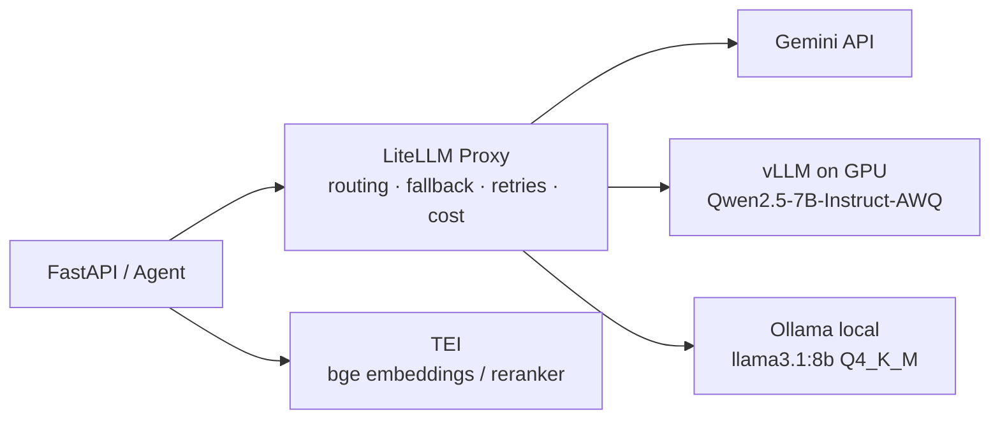

# Phase 5 — Self-Host an Open-Weight Model

**Release tag:** `v0.5-selfhost` · [← Phase 4](../phase-4-evals-observability/README.md) · [Back to roadmap](../../README.md) · [Next: Phase 6 →](../phase-6-production-grade/README.md)

## Goal

Replace (or complement) Gemini with **your own hosted open-weight model**. Build a **model gateway** so models can be **switched by config** and **fall back** automatically when one fails. Publish a **benchmark report**: Gemini vs self-hosted on quality, latency and cost.

## Features

| Feature | Description |
|---|---|
| Local inference | Run quantized models on your laptop with Ollama |
| Production-like inference | vLLM on a rented GPU (RunPod / Modal) with an OpenAI-compatible API |
| Model gateway | One OpenAI-compatible endpoint in front of all models |
| Config-based switching | Change `model: qwen-local` → `gemini-flash` without code changes |
| Fallback & retries | If primary times out or errors, route to secondary |
| Self-hosted embeddings | TEI serves the embedding (and reranker) model |
| Benchmark report | Phase 4 evals + load tests on each model, results in a table |

## Architecture



## Tools & Why

| Tool | Role in this phase | Notes |
|---|---|---|
| **Ollama** | Easiest local inference, GGUF quantized models | `ollama run qwen2.5:7b`; OpenAI-compatible at `:11434/v1` |
| **vLLM** | High-throughput GPU serving (PagedAttention, continuous batching) | `vllm serve Qwen/Qwen2.5-7B-Instruct-AWQ --quantization awq` |
| **RunPod / Modal** | Rent GPUs (e.g. L4, A10G, A100) by the hour/second | Modal: Python-defined deployments; RunPod: pods/serverless |
| **Open-weight models** | Qwen 2.5/3, Llama 3.x, DeepSeek (distilled) | Pick 7–8B for cost; must support tool calling for Phase 3 |
| **Quantization (AWQ / GGUF)** | Smaller memory, faster inference, small quality loss | AWQ for vLLM, GGUF for Ollama/llama.cpp |
| **LiteLLM** | Model gateway: one API, routing, fallbacks, retries, budgets, cost tracking | Run as proxy; integrates with Langfuse |
| **TEI** (Text Embeddings Inference) | Serves embedding and reranker models | Hugging Face container; replaces Gemini embeddings |
| **Locust / k6** | Load testing for latency and throughput | Measures p50/p95, tokens/s |

## LiteLLM Config Example

```yaml
model_list:
  - model_name: chat-primary
    litellm_params:
      model: openai/Qwen/Qwen2.5-7B-Instruct-AWQ
      api_base: os.environ/VLLM_BASE_URL
  - model_name: chat-fallback
    litellm_params:
      model: gemini/gemini-2.0-flash
      api_key: os.environ/GEMINI_API_KEY
  - model_name: chat-local
    litellm_params:
      model: ollama/qwen2.5:7b
      api_base: http://ollama:11434

router_settings:
  fallbacks: [{"chat-primary": ["chat-fallback"]}]
  num_retries: 2
  timeout: 30

litellm_settings:
  success_callback: ["langfuse"]
```

The app only calls `chat-primary`; switching models is a config change.

## Benchmark Report Template

| Model | Faithfulness | Relevancy | Recall@5 | Route acc. | p50 latency | p95 latency | Tokens/s | Cost / 1K req |
|---|---|---|---|---|---|---|---|---|
| Gemini Flash | – | – | – | – | – | – | – | – |
| Qwen2.5-7B AWQ (vLLM, L4) | – | – | – | – | – | – | – | – |
| Llama 3.1 8B Q4 (Ollama, laptop) | – | – | – | – | – | – | – | – |

**Self-hosted cost** = GPU $/hour ÷ requests per hour at your measured throughput.

## Implementation Steps

1. Run Ollama locally; point the app at it via an OpenAI-compatible client.
2. Add LiteLLM proxy to Docker Compose; route all LLM calls through it.
3. Deploy vLLM on RunPod or Modal with an AWQ model; secure it with an API key.
4. Configure fallbacks; test by stopping vLLM and confirming requests go to Gemini.
5. Serve embeddings with TEI; re-index documents (embedding dims may change!).
6. Run Phase 4 evals per model; run load tests with Locust/k6.
7. Write the benchmark report (`BENCHMARK.md`) with tables and conclusions.

## Key Concepts to Learn

- Quantization formats and their quality/speed trade-offs.
- KV cache, PagedAttention, continuous batching.
- Throughput vs latency, and how batch size affects both.
- When self-hosting is cheaper than an API (high, steady volume) and when it isn't.

## Definition of Done / Demo

- [ ] Switch model with a config change only
- [ ] Kill the primary model and requests still succeed via fallback
- [ ] Embeddings served by TEI
- [ ] `BENCHMARK.md` with real numbers and a recommendation

## Interview Talking Points

- Your benchmark results and the trade-off you'd recommend for production.
- How the gateway gives vendor independence and resilience.
- What quantization cost you in quality (measured with your evals).
