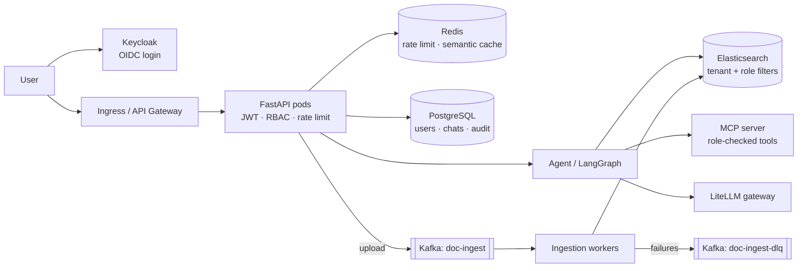

# Phase 6 — Make It Production-Grade

**Release tag:** `v1.0` · [← Phase 5](../phase-5-self-hosted-models/README.md) · [Back to roadmap](../../README.md)

## Goal

Make the system safe and scalable for real users: **authentication**, **multi-tenancy**, **RBAC**, **rate limiting**, **semantic cache**, an **async ingestion pipeline**, and a full **deployment** with CI/CD.

## Features

| Feature | Description |
|---|---|
| Authentication | Login via OIDC (Keycloak); backend validates JWTs |
| Multi-tenancy | Each tenant/user sees only their own docs, chats and tools |
| RBAC | Roles control what users can do in the API, in retrieval, and in agent tools |
| Rate limiting | Per user / per tenant limits on requests and tokens |
| Semantic cache | Similar questions return a cached answer instantly |
| Async ingestion | Upload → Kafka → workers parse/chunk/embed/index, with retries and DLQ |
| Deployment | Docker images, Kubernetes manifests/Helm, GitHub Actions CI/CD |
| Audit log | Who accessed or changed what, and when |

## RBAC (Role-Based Access Control)

### Roles

| Role | Description |
|---|---|
| `admin` | Full control of the tenant: users, roles, models, all documents |
| `manager` | Uploads/deletes documents, uses all tools including write tools, sees team analytics |
| `operator` | Chats, searches docs allowed for operators, uses read-only tools |
| `viewer` | Chats and reads only docs marked public within the tenant; no tools |

### Permission Matrix

| Permission | admin | manager | operator | viewer |
|---|:-:|:-:|:-:|:-:|
| Chat | ✅ | ✅ | ✅ | ✅ |
| Upload / delete documents | ✅ | ✅ | ❌ | ❌ |
| Read restricted documents | ✅ | ✅ | per doc | ❌ |
| Read-only tools (`get_stock`, `get_expiring_skus`) | ✅ | ✅ | ✅ | ❌ |
| Write tools (`create_ticket`, update DB) | ✅ | ✅ | ❌ | ❌ |
| Manage users and roles | ✅ | ❌ | ❌ | ❌ |
| Switch models / view costs | ✅ | ❌ | ❌ | ❌ |
| View audit log | ✅ | ❌ | ❌ | ❌ |

### Where RBAC Is Enforced

1. **API layer:** FastAPI dependency checks roles from JWT claims.
2. **Retrieval layer:** each chunk stores `tenant_id` and `allowed_roles`; every Elasticsearch query adds a filter, so forbidden chunks never reach the LLM.
3. **Agent/tool layer:** each MCP tool declares required roles; the agent only gets tools the user may use, and calls are re-checked server-side.
4. **Cache layer:** semantic cache keys include `tenant_id` and role, so cached answers never leak across permissions.

```python
def require_role(*roles: str):
    async def checker(user: User = Depends(get_current_user)):
        if not set(roles) & set(user.roles):
            raise HTTPException(status_code=403, detail="Forbidden")
        return user
    return checker

@router.post("/api/documents")
async def upload(file: UploadFile, user: User = Depends(require_role("admin", "manager"))):
    ...
```

```json
{ "bool": { "filter": [
  { "term":  { "tenant_id": "<user.tenant_id>" } },
  { "terms": { "allowed_roles": ["<user.roles>"] } }
] } }
```

## Architecture



## Tools & Why

| Tool | Role in this phase | Notes |
|---|---|---|
| **Keycloak** | Identity provider: login, users, realms per tenant, roles in JWT | Alternative: Auth0 / Cognito, or FastAPI OAuth2 + JWT yourself |
| **FastAPI security** (`python-jose` / `PyJWT`) | Validates JWT, extracts `tenant_id` and roles | Dependencies for auth and RBAC |
| **Casbin / OpenFGA** (optional) | Fine-grained policy engine (per-document sharing) | Use when simple roles are not enough |
| **Redis** | Rate limiting (sliding window / token bucket) and semantic cache | `slowapi` or custom Lua; **RedisVL** for vector-based semantic cache |
| **Kafka** (`aiokafka`) | Ingestion queue: decouples upload from processing | Topics `doc-ingest`, `doc-ingest-dlq`; alternative: Celery + Redis |
| **Docker** | Container images for API, workers, MCP server, frontend | Multi-stage builds, non-root user |
| **Kubernetes** (+ Helm) | Deploys everything; autoscaling with HPA | Start with kind/minikube, then a managed cluster (GKE/EKS) |
| **GitHub Actions** | CI: lint, tests, evals; CD: build, push images, deploy | Environments for staging and production |
| **Secrets management** | K8s Secrets / External Secrets / Vault | Never commit API keys |

## Semantic Cache Flow

1. Embed the incoming question.
2. Search Redis vector index scoped to `tenant_id` + role set.
3. If cosine similarity ≥ threshold (e.g. 0.95) → return cached answer (mark as cached in trace).
4. Otherwise run the pipeline, then store question embedding + answer with a TTL.
5. Invalidate a tenant's cache when its documents change.

## Rate Limiting

| Scope | Example limit |
|---|---|
| Per user | 20 requests/min, 100K tokens/day |
| Per tenant | 500 requests/min |
| Upload | 10 files/hour for `manager` |

Return `429 Too Many Requests` with a `Retry-After` header.

## Implementation Steps

1. Keycloak in Docker Compose; realm, client, roles; frontend login with OIDC (`next-auth`).
2. Backend JWT validation; add `tenant_id` to every table and ES document.
3. RBAC: `require_role` dependencies, ES filters, tool permission checks, audit log table.
4. Redis rate limiter middleware; semantic cache around the agent.
5. Move ingestion to Kafka producer (API) + consumer workers, with retries and DLQ; status updates via SSE/polling.
6. Dockerfiles for every service; Helm chart or K8s manifests; HPA for API and workers.
7. GitHub Actions: test → eval gate → build/push images → deploy to staging → manual approval → production.
8. Load test the deployed system and record results.

## Key Concepts to Learn

- Authentication vs authorization; OIDC and JWT claims.
- Tenant isolation strategies (shared index with filters vs index per tenant).
- Why access control must happen **before** retrieval, not after generation.
- Idempotent consumers, retries and dead-letter queues.
- Horizontal scaling and stateless services.

## Definition of Done / Demo

- [ ] Two users from different tenants see only their own docs and chats
- [ ] A `viewer` can't upload docs or trigger tools (gets 403); restricted docs never appear in citations
- [ ] Burst of requests returns 429
- [ ] Repeated question returns instantly from cache
- [ ] Uploading 20 files processes asynchronously; a bad file lands in the DLQ
- [ ] Merging to `main` deploys to Kubernetes via GitHub Actions

## Interview Talking Points

- How you enforce RBAC across API, retrieval, tools and cache, and why retrieval-time filtering matters.
- Semantic cache hit rate and latency/cost savings.
- How the async pipeline handles failures and scales.
- Your CI/CD pipeline with the eval gate.
